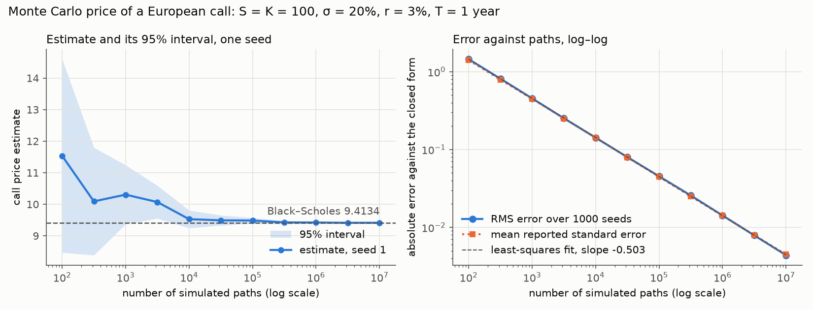

# README

## Overview

Header-only C++17 tools for pricing European options under the Black-Scholes model: closed-form prices and Greeks, an `Option` class, an implied-volatility solver and a seeded Monte Carlo pricer that reports its standard error and 95% interval. Constant rate, no dividends, no early exercise.

The tests and the study in `bench/` check each method against an independent one: the Greeks against finite differences of the price, the solver by round trip, the Monte Carlo price against the closed form, and put-call parity directly. Results, method and the defects the audit found are in [bench/RESULTS.md](bench/RESULTS.md).

## Files

- **BlackScholes.hpp**: `BSCall`, `BSPut` and the delta, gamma, vega and theta of each.
- **options.hpp** / **options.cpp**: the `Option` class (strike, expiry, `"call"` or `"put"`), which dispatches to the functions above.
- **ImpliedVol.hpp**: `implied_vol`, the implied volatility of a call price.
- **MonteCarlo.hpp**: `MCPrice`, the Monte Carlo price with its standard error and 95% interval.
- **NormalDistribution.hpp** / **NormalDistribution.cpp**: normal pdf and cdf.
- **main.cpp**: a minimal program that builds an `Option`.
- **tests/**: `test_pricing.cpp` (prices, Greeks, `Option`, solver), `test_mc.cpp` (Monte Carlo), `test_normal.cpp` (the normal cdf and small prices against `normal_reference.py`'s 800-digit references) and `grid.hpp` (the parameter grid).
- **bench/**: the study (`study.cpp`), the scripts that run it and draw the figure, and the committed outputs; `web_tests.sh`, which records the native and WebAssembly tests in `raw/web_tests.txt`; `check_web_tests.sh`, which checks that a failed run leaves that record as it was; and `mc_coverage.mjs`, which measures how often Monte Carlo's 95% interval holds (`raw/mc_coverage.txt`).
- **web/**: the WebAssembly build (below): `pricer_wasm.cpp` (the binding), `post.js` (argument checks), `build.sh`, `test.mjs`, `driver.cpp` (the native side of the tests) and `test_hooks.cpp` (test module only).
- **.github/workflows/wasm.yml**: native and WebAssembly builds and tests on pull requests and on `main`; releases from `v*` tags.

## Conventions

- `vol` and `rate` are percentages: 20 means 20%.
- `time` is the valuation date and `expiry` the expiry date, both in years; the time to expiry is `expiry - time`.
- Vega is per vol point (per 1%); theta is per calendar day (per year / 365).
- At expiry or at zero vol the price is the discounted payoff. The Greeks take their limits there away from the strike; at the strike itself they are undefined and return NaN.
- `implied_vol(price, spot, strike, expiry, rate, &iterations)` takes a call price and a time to expiry. It throws `std::invalid_argument` for a price outside `(max(S - K e^{-rT}, 0), S)`.

## Build and test

Needs CMake 3.16 or later and a C++17 compiler.

```sh
git clone https://github.com/jideoyelayo1/black-scholes-options.git
cd black-scholes-options
cmake -S . -B build -DCMAKE_BUILD_TYPE=Release
cmake --build build
ctest --test-dir build --output-on-failure
```

## The study

```sh
bench/run.sh          # tests, study and figure; about 8 minutes on an Apple M1 Pro
bench/run.sh 100      # the same with 100 seeds per path count instead of 1000
```

`bench/run.sh` writes the test log, the study's CSVs and summary, and `bench/mc_convergence.png`. The figure needs matplotlib, which the script installs with [uv](https://docs.astral.sh/uv/) into `bench/.venv`; the C++ code has no Python dependency.

Results (details, tolerances and method in [bench/RESULTS.md](bench/RESULTS.md)):

- **Closed form.** Put-call parity holds to 2.8e-14 over a 630-point grid of spot, expiry, vol and rate; every Greek agrees with a finite difference of the price within its stated tolerance; reference values from Hull match.
- **Implied vol.** Every grid point with vega >= 1e-5 per vol point round-trips to within 2.4e-10 vol points, in at most 37 iterations (median 5). Below that vega the price barely moves with vol: 112 prices that round to a no-arbitrage bound are rejected, 26 deep out-of-the-money prices (1e-303 to 1e-44) do not converge in 100 iterations, and 29 of the other 88 solve to a vol that reproduces the price but misses the input by more than 1e-6 points.
- **Monte Carlo.** For S = K = 100, vol 20%, r 3%, T = 1 (closed form 9.4134), over 1000 seeds at each of 11 path counts from 10^2 to 10^7: RMS error falls with slope -0.5026 +/- 0.0008 on log-log axes, and the 95% interval covers the closed form in 94.65% of 11,000 runs.



## Usage

```cpp
#include "options.hpp"
#include "ImpliedVol.hpp"
#include "MonteCarlo.hpp"

Option call(100, 1, "call");                      // strike 100, expiry 1 year
double price = call.price(100, 0, 20, 3);         // spot 100, today, vol 20%, rate 3%
double delta = call.delta(100, 0, 20, 3);
double vol = implied_vol(price, 100, 100, 1, 3);  // 20
MCResult mc = MCPrice(true, 100, 0, 100, 1, 20, 3, 1000000, 42);  // mc.price, mc.std_error, mc.ci_low, mc.ci_high
```

## Limits

European options under constant rate and volatility only: no dividends, early exercise, stochastic volatility, transaction costs or calibration to market data. The checks show internal consistency, not that the model describes a market. The solver handles calls; a put's implied vol is that of the call with the same strike and expiry, by parity. Seeded Monte Carlo results reproduce with the same standard library; `std::normal_distribution` differs between libc++ and libstdc++.

## WebAssembly (`web/`)

The library compiled to WebAssembly for a web page: the closed-form price and Greeks, the implied-vol solver and the Monte Carlo pricer, as three stateless functions that take one object of numbers and return one object of numbers. Nothing else is exposed, and nothing is added to the library.

Needs [emsdk](https://github.com/emscripten-core/emsdk) with Emscripten 6.0.13 (CI checks out emsdk at commit `35659964bc2762fffec0d257997fb61475f765b7`, its tag `6.0.13`), CMake and Node. From the repository root:

```sh
source path/to/emsdk/emsdk_env.sh
web/build.sh                          # web/dist/pricer.mjs, pricer.wasm, BUILD.txt, SHA256SUMS (and the test module)
cmake -S . -B build -DCMAKE_BUILD_TYPE=Release && cmake --build build   # includes web_driver, the native side of the tests
node web/test.mjs build/web_driver
bench/web_tests.sh                    # all of the above, recorded in bench/raw/web_tests.txt
bench/check_web_tests.sh              # a failed run of it leaves that record as it was
node bench/mc_coverage.mjs > bench/raw/mc_coverage.txt   # Monte Carlo's coverage, 19 to 26 minutes here
```

`web/build.sh` calls `em++` directly: C++17, `-O2`, `-fexceptions`, single-threaded, no filesystem, `-sMODULARIZE -sEXPORT_ES6 -sENVIRONMENT=web,node -sALLOW_MEMORY_GROWTH`. With Emscripten 6.0.13 the loader is 36,897 bytes and the `.wasm` 50,526 (10,358 and 24,801 gzipped; `bench/raw/web_tests.txt`). `web/dist/` is not committed: a `v*` tag on a commit on `main` makes CI attach `pricer.mjs`, `pricer.wasm`, `BUILD.txt` (Emscripten version, source commit, command, sizes) and `SHA256SUMS` to a GitHub Release.

### API

`pricer.mjs` exports a factory; the module it resolves to has three functions and `limits`. Call the factory with no options, as below: Emscripten runs options such as `onRuntimeInitialized` or `preRun` before `web/post.js` has removed the raw, unchecked functions, so page code passed that way could keep them and call them with anything. The checks guard against a page's mistakes, not against the page itself. Units are the library's: `vol` and `rate` in percent (20 means 20%), `expiry` the time to expiry in years (the valuation time is 0), vega per vol point, theta per calendar day. Theta is the change in value as one calendar day passes: minus the derivative with respect to the time to expiry, divided by 365, so usually negative.

| Function | Arguments (all required, no others) | Result |
|---|---|---|
| `price` | `type` (`'call'` or `'put'`), `spot`, `strike`, `expiry`, `vol`, `rate` | `{ok: true, price, delta, gamma, vega, theta}` |
| `impliedVol` | `price` (of a call), `spot`, `strike`, `expiry`, `rate` | `{ok: true, vol, iterations}` |
| `monteCarlo` | `type`, `spot`, `strike`, `expiry`, `vol`, `rate`, `paths`, `seed` | `{ok: true, price, stdError, ciLow, ciHigh, closedForm, inTheMoneyPaths, volRootT}` |

`price` is never negative (a price below zero by rounding is returned as 0). `ciLow` and `ciHigh` are the 95% interval, `price` -/+ 1.96 `stdError`; `closedForm` is `price()`'s price for the same inputs. `inTheMoneyPaths` is how many of the simulated paths finished in the money (a positive payoff), counted in the loop that prices them, and `volRootT` is vol x sqrt(T), with vol as a fraction (0.2 for 20% over one year): the two quantities against which the README tabulates how often the 95% interval holds (below). `limits` is a frozen object of `{min, max}` ranges only, one per argument, `{spot: {min, max}, ...}` (below), so that a page can iterate over it.

```js
import createPricer from './pricer.mjs';   // pricer.wasm is fetched from next to it
const pricer = await createPricer();

pricer.price({ type: 'call', spot: 100, strike: 100, expiry: 1, vol: 20, rate: 3 });
// {ok: true, price: 9.413403383853016, delta: 0.5987063256829237, gamma: 0.01933340584014246,
//  vega: 0.38666811680284924, theta: -0.014740816557703214}
pricer.impliedVol({ price: 9.413403383853016, spot: 100, strike: 100, expiry: 1, rate: 3 });
// {ok: true, vol: 19.999999999999993, iterations: 4}
pricer.monteCarlo({ type: 'call', spot: 100, strike: 100, expiry: 1, vol: 20, rate: 3, paths: 1000000, seed: 42 });
// {ok: true, price: 9.434143734972519, stdError: 0.014141785963166932, ciLow: 9.406426343807638,
//  ciHigh: 9.4618611261374, closedForm: 9.413403383853016, inTheMoneyPaths: 520463, volRootT: 0.2}
pricer.impliedVol({ price: 2, spot: 120, strike: 100, expiry: 1, rate: 3 });
// {ok: false, error: 'below_lower_bound', message: 'impliedVol: a call price must be above max(S - K exp(-rT), 0) = 22.95544665; got 2'}
```

### Refusals

No function throws. A call that cannot be answered returns `{ok: false, error, message}`: `error` is one of the names below, `message` is for people and names the argument; it echoes at most 20 characters of a caller's string and only the type of anything else. Arguments are checked in JavaScript (`web/post.js`) before anything enters WebAssembly, and nothing is coerced: `'100'`, `true`, `null`, `100n` and `new Number(100)` are not numbers.

| `error` | When |
|---|---|
| `expected_one_object` | not exactly one argument, or it is not an object (null, an array, a number, a string) |
| `unknown_argument` | a field that is not one of the function's (a misspelling such as `volatility`), non-enumerable and symbol-keyed ones included |
| `missing_argument` | a field is missing (inherited fields do not count) |
| `unreadable_argument` | reading the object threw (a throwing getter or proxy, a revoked proxy) |
| `unknown_type` | `type` is not exactly `'call'` or `'put'` |
| `not_a_number` | a field is not of type number |
| `not_finite` | NaN or an infinity |
| `not_an_integer` | `paths` or `seed` is not a whole number |
| `out_of_range` | outside the limits below, zero and negative values included |
| `below_lower_bound` | `impliedVol`: the price is at or below max(S - K e^{-rT}, 0), so no vol gives it |
| `above_upper_bound` | `impliedVol`: the price is at or above the spot |
| `vol_above_bracket` | `impliedVol`: the vol is above 1000%, the top of the solver's bracket |
| `not_converged` | `impliedVol`: no convergence in 100 iterations, for a call price exponentially small beside the spot (in the tests, at most 3.8e-33 of it): the solver keeps any Newton step that halves the price error, and from above Newton cuts such an error only by about a factor e per step, so its bisection fallback never takes over (26 of the grid's 630 call prices; 700 and 1,055 of the samples' 20,000) |
| `internal_error` | a C++ exception, caught inside WebAssembly (none is reachable through the checked functions; the tests force them through a hook) |

Nothing is thrown from C++ into JavaScript, since such an exception would leave WebAssembly's stack pointer unrestored: every bound function catches C++ exceptions and returns a refusal. `web/test.mjs` makes 100,000 refused calls of each kind on the release module and on a test module (`build/wasm-test/`, never released, with `stackPointer()`, `heapSize()` and an unchecked Monte Carlo call), and checks that the stack pointer and the memory size have not changed and that results are bit for bit as before.

### Limits

| Argument | Allowed (inclusive) | Why |
|---|---|---|
| `spot`, `strike` | 0.01 to 1,000,000 | positive; every output is finite at every corner of the allowed ranges (64 corners, call and put, checked) |
| `expiry` | 0.0001 to 100 years | positive: at zero the library's Greeks are NaN at the strike |
| `vol` | 0.01% to 1000% | positive; 1000% is the top of the implied-vol solver's bracket |
| `rate` | -10% to 100% | negative rates multiply the strike by e^{-rT}, and the price's rounding error grows with S + K e^{-rT}; the floor keeps e^{-rT} under e^{10} |
| `paths` | 1,000 to 2,000,000 | 1,000 is a floor, not the point where the interval holds: at 100 paths the at-the-money call's interval covered 93.9%, 92.9% and 89.3% at vol x sqrt(T) 0.25, 0.5 and 1 (10,000 seeds, `bench/raw/mc_coverage.txt`; the library's own minimum is 2); the top bounds the work, which is proportional to paths. The largest call took 0.066 to 0.127 s for S = K = 100, T = 1, vol 20%, and 0.220 to 0.329 s in the slowest case found (S = K = 0.01, T = 100, vol 375%, r -10%: most terminal spots are subnormal numbers, which the exponential is slow to produce), on an Apple M1 Pro under a load average near 170 (first call in a fresh Node process, then two more; `bench/raw/web_tests.txt`), so a laptop a few times slower stays near a second |
| `seed` | 0 to 2^53 - 1 | whole numbers a JavaScript number holds exactly |

The closed form and the solver are bounded work (the solver stops after 100 iterations), so `paths` is the only cap on time. No call keeps memory: over the 1.3 million refused calls of the tests the module's memory stayed at 16,908,288 bytes.

One corner of these limits gives a poor standard error. `MCPrice` computes it in one pass, as the sum of squares less paths times the mean squared, which cancels when the payoff hardly varies. Deep in the money with vol 0.01% and expiry 1e-4 years, the payoff's standard deviation is 1e-6 of its mean, and at 2,000,000 paths the reported standard error was 8.6% low to 1.9% high against the exact one (S = 100 and 1,000,000, K = 0.01, seeds 1 and 2), against within 0.02% at vol 20% and T = 1 (`bench/raw/web_tests.txt`). The estimator is the library's and is left as it is: changing it would change every seeded result, the study's included.

### What is and is not guaranteed

- **Agreement with the native build** (`web/test.mjs` against `web/driver.cpp`, which calls the library directly; macOS arm64, Apple clang, libc++). Not bit for bit in general: the two builds use different maths libraries and the native arm64 build fuses multiplies and adds. Over the grid of `tests/grid.hpp` and two seeded samples of 20,000 points each (one over all the limits, one near the money), every price and Greek agrees within 1e-12 of the size of the terms its formula combines (S + K e^{-rT} for the price); the largest difference was 2.15e-14 of that, and 6,407 to 19,225 of each 20,000 were bit-identical. Implied vols agree within 1e-7 vol points wherever the price determines the vol (largest 1.60e-9). Seeded Monte Carlo uses the same random numbers in both builds (libc++'s `std::normal_distribution` on `std::mt19937_64`): 7 of 20 runs of 10^6 paths were bit-identical and the largest relative difference was 1.31e-14.
- **Repeatable in WebAssembly.** The same inputs and seed give the same bits on every call; one seeded Monte Carlo result is pinned bit for bit in `web/test.mjs`, which CI runs on another machine.
- **Monte Carlo is an estimate**, with its own estimated standard error, and its 95% interval is not a guarantee. When few paths finish in the money, or vol x sqrt(T) is large, the payoff is so skewed that the sample misses the rare paths that carry the price, and the standard error, estimated from the same sample, misses them too. Each result reports both quantities, `inTheMoneyPaths` and `volRootT`, so that a caller can judge. `bench/mc_coverage.mjs` measured how often the interval contains the closed form, through the module, for calls and puts with S = 100, T = 1, r 3%, strikes 50 to 200, vol x sqrt(T) 0.2 to 1.5 and 1,000 to 100,000 paths, with 500 to 10,000 seeds per option (`bench/raw/mc_coverage.txt`, where every coverage has its 95% interval and run count). What it found, as guidance:
  - **Paths in the money matter most.** With none, the estimate is 0 with a standard error of 0 and the interval never covers; with fewer than about 30, coverage was far below 95%: no option whose runs typically had fewer than 30 in the money covered more than 88.4% at 1,000 paths, 75.3% at 10,000 or 92.2% at 100,000. The cases a page is likely to meet:

| Option (S = 100, T = 1, r 3%) | 1,000 paths | 10,000 paths | 100,000 paths |
|---|---|---|---|
| call, strike 200, vol x sqrt(T) 0.2 | 0.258 (0 in the money) | 0.753 (3 in the money) | 0.932 (31 in the money) |
| put, strike 60, vol x sqrt(T) 0.2 | 0.819 (4 in the money) | 0.928 (46 in the money) | 0.946 (463 in the money) |
| put, strike 50, vol x sqrt(T) 0.2 | 0.185 (0 in the money) | 0.700 (2 in the money) | 0.922 (22 in the money) |
| call, strike 160, vol x sqrt(T) 0.2 | 0.884 (11 in the money) | 0.944 (107 in the money) | 0.920 (1072 in the money) |
| call, strike 200, vol x sqrt(T) 1.5 | 0.910 (117 in the money) | 0.937 (1166 in the money) | 0.942 (11658 in the money) |

  - **With at least 100 in the money, coverage was about 94 to 95%, not 95%**, at every path count tested (the lowest, 93.4%, at vol x sqrt(T) 1.5 and 1,000 paths). Pooled over all the options' runs with at least 100 paths in the money, by vol x sqrt(T):

| Paths | 0.2 | 0.5 | 0.75 | 1 | 1.25 | 1.5 | all |
|---|---|---|---|---|---|---|---|
| 1,000 | 0.949 | 0.950 | 0.950 | 0.947 | 0.943 | 0.934 | 0.945 |
| 10,000 | 0.945 | 0.945 | 0.945 | 0.945 | 0.945 | 0.941 | 0.944 |
| 100,000 | 0.945 | 0.944 | 0.942 | 0.940 | 0.941 | 0.940 | 0.942 |

    Options whose runs typically had at least 100 in the money and vol x sqrt(T) at most 1 covered 93.6% to 95.4% at 1,000 paths, 93.8% to 95.4% at 10,000 and 92.0% to 95.8% at 100,000 (500 seeds there, so wider intervals).
  - **Large vol x sqrt(T) lowers coverage for calls at small path counts**, whose payoff is unbounded; puts, bounded by the strike, held up. At the money, 10,000 seeds at 1,000 paths:

| vol x sqrt(T) | call | put |
|---|---|---|
| 0.25 | 0.947 (498 in the money) | 0.951 (502) |
| 0.5 | 0.947 (425 in the money) | 0.951 (575) |
| 0.75 | 0.946 (369 in the money) | 0.950 (631) |
| 1 | 0.942 (319 in the money) | 0.948 (681) |
| 1.25 | 0.935 (274 in the money) | 0.947 (726) |
| 1.5 | 0.917 (233 in the money) | 0.946 (767) |

  - **Binned by the observed count**, pooled over everything (a run with fewer paths in the money than usual also tends to underestimate, so a bin mixes options):

| inTheMoneyPaths | 1,000 paths | 10,000 paths | 100,000 paths |
|---|---|---|---|
| 0 | 0.000 (n 7650) | 0.000 (n 304) | - |
| 1-9 | 0.833 (n 9098) | 0.786 (n 3692) | - |
| 10-29 | 0.969 (n 3252) | 0.688 (n 16) | 0.902 (n 650) |
| 30-99 | 0.894 (n 7242) | 0.913 (n 2461) | 0.974 (n 350) |
| 100-299 | 0.939 (n 107251) | 0.976 (n 1527) | - |
| 300-999 | 0.948 (n 277857) | 0.931 (n 2184) | 0.941 (n 505) |
| 1000-2999 | 0.948 (n 7650) | 0.944 (n 43816) | 0.925 (n 495) |
| 3000-9999 | - | 0.945 (n 113696) | 0.942 (n 500) |
| 10000-29999 | - | 0.931 (n 304) | 0.944 (n 11000) |
| 30000-99999 | - | - | 0.941 (n 28500) |

  No simple rule in these two quantities separates good coverage from bad sharply. As guidance only: read the interval as roughly 95% when `inTheMoneyPaths` is at least 100 and `volRootT` at most 1 (pooled coverage 94.0% to 95.0% there, single options 92.0% to 95.8%); treat it as unreliable when `inTheMoneyPaths` is below 30, and as optimistic for a call when `volRootT` is above 1 and paths are few. Measured at S = 100, T = 1 and r 3% only.
- **The implied vol** is that of a call (a put's is the call's at the same strike and expiry, by parity). Where vega is below 1e-7 x (S + K e^{-rT}) per vol point the price barely moves with vol, and the solver can return a vol that reproduces the price but is far from the one that made it; within 1e-12 of S + K e^{-rT} of the lower bound (a price at the in-the-money bound, or a tiny one far out of the money) the two builds' rounding decides, and one may refuse the price, or stop at 100 iterations, where the other solves it. For a call price exponentially small beside the spot the solver stops at 100 iterations and refuses with `not_converged`; before the cdf change the module instead returned a wrong vol without warning, 158.25% for a price whose vol is 50% (S = 50, K = 100, T = 1/365, r 0).
- **A study, not a trading tool**: European options under Black-Scholes with constant rate and volatility, no dividends, no early exercise, no rho. The checks show the module computes the model as the native library does, not that the model describes a market.

Known limits: the formula subtracts one term from another, so the library's price can come out a little below zero by rounding (natively, down to -3.19e-17 of S + K e^{-rT} in the samples); `price` and `closedForm` return 0 instead, but the Greeks are returned as computed, so one that rounds to zero can print as `-0.0000` with `toFixed` (`(Math.round(x * 1e4) / 1e4 || 0).toFixed(4)` prints `0.0000`); the normal cdf is computed as erfc(-x / sqrt(2)) / 2, which keeps its relative accuracy in the lower tail (within 1.2e-13 of an 800-digit reference down to x = -37, and small prices within 1.5e-10 in the cases of `tests/test_normal.cpp`), but where a price is the difference of two nearly equal terms its error is still about 1e-16 x (S + K e^{-rT}) in absolute terms; the module is built for browsers' main thread and Node (`-sENVIRONMENT=web,node`), not for a Web Worker; and it was tested in Node only, on macOS (no browser, no Linux).

## License

This project is licensed under the MIT License.

## Contributions

Contributions are welcome! Please fork the repository and submit a pull request for any enhancements or bug fixes.

## Contact

For any questions or issues, please open an issue on GitHub or contact the repository owner.
