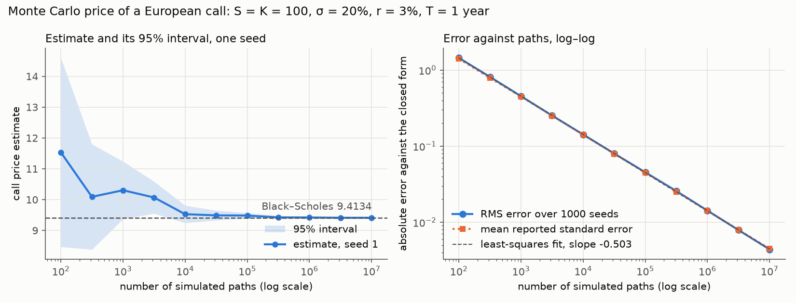

# Results

The option-pricing study: an audit of the 2024 pricer, the implied-volatility round trip, and Monte Carlo error and coverage against the closed form. Every number here comes from a file in this directory, produced by the commands below.

## How to reproduce

```sh
bench/run.sh              # build, tests, study and figure (1000 seeds per path count)
bench/audit_original.sh   # the current pricing tests against the headers before the fixes
```

| Output | Written by | Contents |
|---|---|---|
| `environment.txt` | `run.sh` | OS, CPU, compiler, CMake, build flags |
| `test_output.txt` | `run.sh` | both test binaries: worst residuals and the pass count |
| `study_output.txt` | `run.sh` | the study's summary, quoted below |
| `iv_roundtrip.csv` | `study` | every implied-vol case: inputs, price, vega, status, solved vol, error, price residual, iterations |
| `mc_raw.csv` | `study` | every Monte Carlo run: paths, seed, estimate, standard error, interval, error, covered |
| `mc_convergence.csv` | `study` | per path count: RMS error, median absolute error, mean standard error, coverage and its interval |
| `call_curve.csv` | `study` | call price, delta and gamma against spot, K = 100, vol 20%, r 3%, T = 1 |
| `mc_convergence.png` | `plot_convergence.py` | the figure below |
| `audit_original_output.txt` | `audit_original.sh` | the pricing tests run against the original headers |

Hardware and toolchain for every number below (`environment.txt`): Apple M1 Pro, macOS 27.0.1 (Darwin arm64), Apple clang 21.0.0 (clang-2100.3.34.2) with libc++, CMake 4.4.0, `CMAKE_BUILD_TYPE=Release` (`-O3 -DNDEBUG -std=c++17 -Wall -Wextra`), single thread. Plotting: Python 3.13.14, matplotlib 3.11.2, numpy 2.5.5 in `bench/.venv`. Two full runs of `bench/run.sh`, the second with a freshly created venv, gave byte-identical CSVs, logs and figure.

## Decisions fixed before the first run

- **Scope.** European calls and puts, constant rate, no dividends, no early exercise.
- **Grid** (`tests/grid.hpp`): K = 100; S in {50, 80, 95, 100, 105, 120, 200}; T in {1/365, 7/365, 0.25, 1, 5} years; vol in {1, 5, 20, 50, 100, 300}%; r in {0, 3, 10}%. 630 points, each priced as a call and a put.
- **Tolerances**, chosen before the first run and not changed after it:

| Check | Pass if |
|---|---|
| Reference values | within the published rounding (Hull: 4.76 / 0.81; 2.40, 0.522, 0.066, 0.121 per vol point, -0.0118 per day; S = K = 100, r 5%: 10.4506 / 5.5735) |
| Put-call parity, C - P = S - K e^{-rT} | residual <= 1e-10 x K |
| Delta parity, delta_C - delta_P = 1 | residual <= 1e-12 |
| No-arbitrage bounds | max(S - K e^{-rT}, 0) <= C <= S and max(K e^{-rT} - S, 0) <= P <= K e^{-rT}, with 1e-12 x K slack |
| Delta, vega, theta against central differences | abs. difference <= 1e-6 x abs(Greek) + 1e-8 |
| Gamma against a central second difference | abs. difference <= 1e-5 x abs(gamma) + 1e-6 |
| Implied-vol round trip | abs. error <= 1e-6 vol points wherever vega >= 1e-5 per vol point |
| Monte Carlo unit check | within 4 standard errors of the closed form at 10^6 paths, seed 42 |

  Finite-difference steps scale with the width of the price curve, w = S x vol x sqrt(T): 1e-4 w for delta, 1e-3 w for gamma, 1e-4 x vol for vega, 1e-3 x T for theta. The wider gamma tolerance allows for rounding in a second difference (about 1e-16 x price / step^2). The vega threshold for the round trip follows from a price rounding error of about 1e-13: below vega 1e-5 per point, that error alone can move the vol by more than 1e-6 points.
- **Random numbers.** `std::mt19937_64`, seeded with the replicate number (1 to 1000) at every path count, and libc++'s `std::normal_distribution` (Marsaglia's polar method). A run with more paths extends the same stream, so each seed traces one running estimate.

## Audit of the 2024 code

`bench/audit_original.sh` runs the current `tests/test_pricing.cpp` against the headers at commit 96a6e44: 57 of 8006 checks fail (`audit_original_output.txt`). The closed-form prices and Greeks were right wherever vol x sqrt(T) > 0: the reference values, parity and every finite-difference check passed. The defects were at the edges, in the class and in the solver.

| Defect | Failing case | Fix | Test |
|---|---|---|---|
| The repo did not link: every function in `BlackScholes.hpp` and `ImpliedVol.hpp` was defined in the header without `inline`, so `main.cpp` and `options.cpp` gave duplicate symbols | `c++ main.cpp options.cpp NormalDistribution.cpp` | `inline`; CMake target `options_demo` links all three | the `options_demo` build |
| Price NaN exactly at the strike at expiry, and at the forward with zero vol (d1 = 0/0) | `BSCall(100, 1, 100, 1, 20, 3)`, `BSCall(100, 0, 100, 1, 0, 0)` | return the discounted payoff when vol x sqrt(T) = 0 | `boundaries()` |
| Gamma NaN at expiry or zero vol at any spot; theta NaN at expiry | `BSCall_Gamma(110, 1, 100, 1, 20, 3)`, `BSCall_Theta(110, 1, 100, 1, 20, 3)` | skip the 0/0 when pdf(d1) = 0 | `boundaries()` |
| `Option::set_strike` and `set_expiry` threw before assigning, always | `set_strike(90)` | validate, then assign | `option_class()` |
| Implied vol NaN at the forward (S = K, r = 0): sigma_c = 0 makes F(0) a 0/0 | 30 of 404 well-conditioned round trips | new solver | `implied_vol_checks()` |
| Implied vol NaN for 13 high total-vol cases (vol x sqrt(T) >= 1.5) on the solver's upper branch, whose start `-2 * norm.pdf(pval)` is negative (Jaeckel's guess uses the inverse normal cdf) | e.g. S = 50, T = 0.25, vol 300%, r 0 | new solver | `implied_vol_checks()` |
| Zero or negative call price accepted out of the money | `implied_vol(0, 80, 100, 1, 3)` | lower bound is max(S - K e^{-rT}, 0) | `implied_vol_checks()` |
| `M_PI` redefined over the system's definition (compiler warning) | any build | define only if missing | build has no warnings |

## Closed form

From `test_output.txt`, over the 630-point grid, calls and puts:

| Check | Worst case | Tolerance |
|---|---|---|
| Put-call parity residual | 2.842e-14 | 1e-8 |
| Delta parity residual | 0 | 1e-12 |
| Delta vs finite difference | 0.014 of tolerance | 1 |
| Gamma vs finite difference | 0.057 of tolerance | 1 |
| Vega vs finite difference | 0.060 of tolerance | 1 |
| Theta vs finite difference | 0.901 of tolerance | 1 |

All 8006 checks pass, including every reference value and boundary case, and the 11 Monte Carlo unit checks pass. Theta has the narrowest margin, 0.90 of its tolerance; the step and tolerance stay as declared.

## Implied volatility

Method (`ImpliedVol.hpp`): Newton's method on vol, started at the Manaster-Koehler point sqrt(2 |ln(S/K) + rT| / T), floored at 1%. Bracket [0%, 1000%], narrowed every iteration by the sign of the price error. A Newton step that leaves the bracket, or fails to halve the price error, is replaced by bisection. Stop when a step or the bracket is below 1e-10 vol points; at most 100 iterations. Calls only.

Round trip: price a call on each of the 630 grid points, solve for its vol, compare (`study_output.txt`, every case in `iv_roundtrip.csv`).

| Cases | Count | Outcome |
|---|---|---|
| Well-conditioned, vega >= 1e-5 per vol point | 404 | all solved; worst abs. error 2.911e-10 vol points; iterations median 5, max 19 |
| Ill-conditioned, price at a no-arbitrage bound | 157 | rejected with `std::invalid_argument`: 80 deep out-of-the-money prices that are exactly 0 in double precision, 77 deep in-the-money prices exactly equal to S - K e^{-rT} |
| Ill-conditioned, price inside the bounds | 69 | all solved; 30 within 1e-6 vol points, 39 not; worst abs. error 22.18 vol points (S = 120, T = 1/365, vol 1%, r 3%, vega 0); iterations median 31, max 71 |
| Not converged in 100 iterations / above the 1000% bracket | 0 / 0 | |

Every solved case, including the 39 that miss the vol, reproduces its price to within 2.842e-14. The solver does not fail to converge on this grid; where it returns the wrong vol, the price does not determine the vol in double precision: the largest vega among those 39 cases is 6.2e-9 per vol point, so a vol change of a full point moves the price by less than 1e-8. That is expected near the no-arbitrage bounds (deep in or out of the money, short expiry or low vol), and those cases are excluded from the asserted test by the vega threshold set in advance.

The breakdowns above come from `iv_roundtrip.csv`:

```sh
awk -F, 'NR>1 && $9=="rejected_at_bounds" {print ($6==0 ? "price 0" : "price at S - K exp(-rT)")}' bench/iv_roundtrip.csv | sort | uniq -c
awk -F, 'NR>1 && $8==0 && $9=="converged" && $11>1e-6 {n++; if ($7>m) m=$7} END {print n, m}' bench/iv_roundtrip.csv
```

## Monte Carlo

Method (`MonteCarlo.hpp`): exact sampling of the terminal spot, discounted mean payoff, standard error = sample standard deviation / sqrt(paths), 95% interval = estimate -/+ 1.96 standard errors. No variance reduction.

Option: the European call from the page's example, S = K = 100, vol 20%, r 3%, T = 1 year; closed form 9.413403383853 (put-call parity residual 4.0e-15). Eleven path counts, 10^2 to 10^7 in half decades; at each, seeds 1 to 1000 (11,000 runs, every one in `mc_raw.csv`).



| Paths | Mean estimate | RMS error | Median abs. error | Mean standard error | Coverage of the 95% interval (95% CI) |
|---:|---:|---:|---:|---:|---|
| 100 | 9.495877 | 1.4460 | 1.0156 | 1.4085 | 0.948 (0.934 to 0.962) |
| 316 | 9.390386 | 0.81291 | 0.55288 | 0.79051 | 0.939 (0.924 to 0.954) |
| 1,000 | 9.439227 | 0.45340 | 0.31589 | 0.44716 | 0.949 (0.935 to 0.963) |
| 3,162 | 9.418397 | 0.25197 | 0.17108 | 0.25095 | 0.948 (0.934 to 0.962) |
| 10,000 | 9.415211 | 0.14190 | 0.095435 | 0.14112 | 0.941 (0.926 to 0.956) |
| 31,623 | 9.414830 | 0.079840 | 0.052232 | 0.079359 | 0.949 (0.935 to 0.963) |
| 100,000 | 9.414593 | 0.045286 | 0.028928 | 0.044627 | 0.940 (0.925 to 0.955) |
| 316,228 | 9.413648 | 0.025653 | 0.016771 | 0.025096 | 0.947 (0.933 to 0.961) |
| 1,000,000 | 9.413336 | 0.014200 | 0.0096483 | 0.014111 | 0.946 (0.932 to 0.960) |
| 3,162,278 | 9.413333 | 0.0078722 | 0.0051514 | 0.0079351 | 0.952 (0.939 to 0.965) |
| 10,000,000 | 9.413471 | 0.0043825 | 0.0029594 | 0.0044623 | 0.953 (0.940 to 0.966) |

Least-squares slopes on log-log axes, with the standard error of the fit:

| Quantity against paths | Slope | Expected |
|---|---|---|
| RMS error | -0.5026 +/- 0.0008 | -1/2 |
| Median abs. error | -0.5069 +/- 0.0019 | -1/2 |
| Mean reported standard error | -0.4998 +/- 0.0001 | -1/2 |

Coverage: at every path count the binomial interval on coverage contains 0.95; pooled over all 11,000 runs, 10,412 intervals (0.9465) contain the closed form. The reported standard error tracks the actual RMS error to within 3% at every path count (largest gap at 316 paths: 0.791 against 0.813).

Two cautions on reading these. The coverage interval in the table is the normal approximation to a binomial over 1000 seeds. And because a seed's longer runs extend its shorter ones, the 11 path counts are not independent samples, so the standard errors on the slopes are smaller than a fit to independent points would give.

## Not measured or not claimed

- Speed. The study is single-threaded and no timing is reported.
- Results with libstdc++ or MSVC: `std::normal_distribution` differs, so seeded numbers differ; the statistics should not, but that was not run. GCC was not available on this machine (`g++` is Apple clang).
- Puts in the implied-vol solver, rho, dividends, American exercise, variance reduction: none are in scope.
- Anything about markets: these checks show internal consistency of the model, not that it describes prices.
